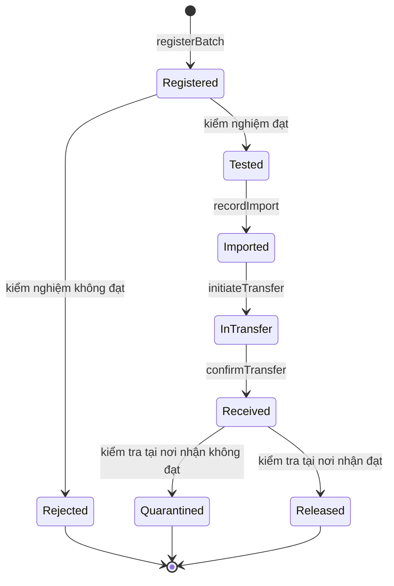

# Batch Registry: truy xuất nguồn gốc nguyên liệu dược phẩm trên blockchain

Đồ án nhóm môn **Blockchain & Hợp đồng thông minh** (BIM5017), Trường Đại học Kinh tế - Luật, ĐHQG TP.HCM.

Một sổ đăng ký dựa trên smart contract, ghi lại lịch sử của một lô nguyên liệu dược từ lúc nhà sản xuất đăng ký đến khi nhà máy dược kiểm tra và cho phép sử dụng. Mỗi bước tạo một sự kiện trên blockchain kèm mã băm của hồ sơ gốc, nên ai cũng có thể tra lại lịch sử và phát hiện hồ sơ đã bị chỉnh sửa.

> Đây là mô hình minh họa chạy trên mạng thử nghiệm với dữ liệu mẫu. Hệ thống không thay thế và không chứng nhận việc tuân thủ GMP.

## Trạng thái hiện tại

Dự án đang ở giai đoạn thiết kế: proposal đã xong, repo chưa có mã nguồn. Phần [Lộ trình](#lộ-trình) liệt kê những gì sẽ được xây dựng.

## Nhóm thực hiện

Nhóm 5, giảng viên hướng dẫn: TS. Trịnh Quang Việt.

- Lê Nguyễn Mỹ Duyên
- Nguyễn Nhật Huy
- Nguyễn Yến Ngân
- Đoàn Phương Nghi

## Bài toán

Phần lớn nguyên liệu dược dùng tại Việt Nam phải nhập khẩu. Một lô đi qua nhiều tổ chức độc lập (nhà sản xuất, đơn vị kiểm nghiệm, nhà nhập khẩu, nhà máy dược), và mỗi bên giữ một phần hồ sơ trong hệ thống riêng. Khi có sự cố chất lượng, việc gom và đối chiếu hồ sơ giữa các bên mất thời gian, và khó chứng minh một tài liệu chưa bị sửa sau khi phát hành.

Dự án dùng blockchain làm lớp ghi nhận lịch sử dùng chung giữa các bên:

- **Lịch sử chỉ bổ sung**: sự kiện đã ghi không bị ghi đè hay xóa.
- **Đối chiếu bằng mã băm**: hồ sơ gốc nằm ngoài chuỗi, mã băm SHA-256 nằm trên chuỗi.
- **Phân quyền theo vai trò**: mỗi bên chỉ ghi được phần việc của mình, đúng trạng thái của lô.

### Phạm vi

Trong phạm vi: đăng ký lô, kiểm nghiệm, nhập khẩu, chuyển giao, xác nhận tiếp nhận, kiểm tra tại nơi nhận, và tra cứu lịch sử.

Ngoài phạm vi: chia nhỏ hoặc gộp lô, quá trình sản xuất thuốc tại nhà máy, truy xuất nguồn gốc hóa học của nguyên liệu, xử lý khiếu nại khi giao nhận sai, đánh giá tuân thủ GMP.

## Vai trò

| Vai trò | Mô tả |
|---|---|
| Admin | Đối chiếu giấy phép của từng đơn vị ngoài hệ thống, rồi cấp vai trò cho ví tương ứng |
| Manufacturer | Nhà sản xuất nguyên liệu, đăng ký lô ban đầu |
| Inspector | Đơn vị kiểm nghiệm, ghi kết quả kiểm nghiệm |
| Importer | Đơn vị nhập khẩu, ghi thông tin nhập khẩu và khởi tạo chuyển giao |
| Receiver | Bên nhận (nhà máy dược), xác nhận tiếp nhận và kiểm tra chất lượng tại nơi nhận |
| Viewer | Người dùng chỉ đọc, không cần được cấp vai trò |

## Quy trình

| Bước | Bên thực hiện | Hồ sơ off-chain | Sự kiện on-chain | Trạng thái lô |
|---|---|---|---|---|
| 0 | Admin | Giấy phép, hồ sơ pháp lý của đơn vị | `RoleGranted` | Chưa có lô |
| 1 | Manufacturer | COA, MSDS, hồ sơ lô | `BatchRegistered` | `Registered` |
| 2 | Inspector | Phiếu kiểm nghiệm | `BatchTested` | `Tested` hoặc `Rejected` |
| 3 | Importer | Tờ khai hải quan, vận đơn, hóa đơn | `BatchImported` | `Imported` |
| 4 | Importer | Phiếu giao hàng | `TransferInitiated` | `InTransfer` |
| 5 | Receiver | Biên bản nhận hàng | `TransferConfirmed` | `Received` |
| 6 | Receiver | Phiếu kiểm nghiệm tại nơi nhận | `ReceivingInspected` | `Released` hoặc `Quarantined` |

Quy tắc chung:

- Mỗi lô giữ nguyên một mã lô (`batchId`) trong suốt vòng đời.
- Mỗi thao tác chỉ hợp lệ khi đúng vai trò và đúng trạng thái; ngược lại contract từ chối và không ghi gì.
- Importer và Receiver được chỉ định đích danh cho từng lô, và chỉ thao tác được trên lô đó.
- Kết quả kiểm nghiệm (Bước 2) và kết quả kiểm tra tại nơi nhận (Bước 6) chỉ được ghi một lần.
- `Rejected` và `Quarantined` là trạng thái kết thúc.
- Nếu hàng nhận không đúng hoặc không đủ, Receiver không xác nhận và lô giữ trạng thái `InTransfer`.

## Kiến trúc

| Tầng | Thành phần | Công nghệ |
|---|---|---|
| Giao diện | DApp web, form riêng cho từng vai trò, trang truy xuất | HTML/JavaScript, Web3.js |
| Ví | Danh tính trên chuỗi, ký giao dịch | MetaMask |
| Hợp đồng thông minh | Contract `BatchRegistry`: phân quyền, máy trạng thái, phát event | Solidity 0.8.19, Remix |
| Mạng blockchain | Lưu khối, giao dịch, event | Rootstock (RSK) Testnet, Chain ID 31 |
| Băm hồ sơ | Băm file ngay trong trình duyệt | Web Crypto API (SHA-256) |
| Ngoài chuỗi | Siêu dữ liệu phục vụ tìm kiếm và hiển thị | Node.js, JSON Server |

### Dữ liệu nằm ở đâu

- **Trên chuỗi**: trạng thái và người đang giữ lô, cùng các event (ai ghi, lúc nào, thông tin chính, mã băm hồ sơ).
- **Ngoài chuỗi**: file hồ sơ gốc do từng bên tự lưu; JSON Server chỉ giữ siêu dữ liệu như tên đơn vị, tên nguyên liệu, ghi chú.

Chỉ đưa lên chuỗi những gì cần bất biến và gọn, để tiết kiệm phí giao dịch và hạn chế lộ thông tin.

### Luồng ghi

1. Người dùng nhập form và chọn file hồ sơ; DApp băm file bằng SHA-256.
2. DApp gọi hàm của contract qua Web3.js; MetaMask yêu cầu người dùng ký.
3. Contract kiểm tra vai trò người gọi và trạng thái lô.
4. Nếu hợp lệ, contract cập nhật trạng thái và phát event.
5. Sau khi giao dịch thành công, DApp mới lưu siêu dữ liệu vào JSON Server, để hai nơi không lệch nhau.

### Luồng đọc

Người dùng nhập mã lô hoặc quét QR. DApp đọc trạng thái và các event của lô từ chuỗi, không tốn phí và không cần ký. Với từng bước, người dùng chọn lại file hồ sơ đang có; DApp băm lại, so với mã băm trong event và báo **Khớp** hoặc **Không khớp**.

## Chức năng

- **Thêm mới**: cấp vai trò, đăng ký lô, ghi kết quả kiểm nghiệm, ghi nhập khẩu, khởi tạo chuyển giao, xác nhận tiếp nhận, kiểm tra tại nơi nhận.
- **Tìm kiếm**:
  - theo mã lô: trạng thái hiện tại, người đang giữ, dòng thời gian sự kiện;
  - theo số lô hoặc tên nguyên liệu: tìm trong JSON Server, trạng thái luôn đọc lại từ chuỗi;
  - theo mã băm: chọn một file để tìm event có mã băm trùng, biết file thuộc lô nào, bước nào.
- **Xác minh**: đối chiếu mã băm của file với giá trị đã ghi ở đúng bước.
- **Mã QR** dẫn thẳng tới trang truy xuất của một lô (làm nếu còn thời gian).

## Mạng thử nghiệm

| Thông số | Giá trị |
|---|---|
| Mạng | Rootstock Testnet |
| Chain ID | 31 |
| RPC | `https://public-node.testnet.rsk.co` |
| Đơn vị tiền | tRBTC (không có giá trị thật) |
| Explorer | https://explorer.testnet.rootstock.io |
| Faucet | https://faucet.rootstock.io |

Địa chỉ contract sẽ được bổ sung sau khi deploy.

Lưu ý an toàn: chỉ dùng ví thử nghiệm, không dùng ví có tiền thật, và không commit khóa riêng hay seed phrase vào repo.

## Lộ trình

| Tuần môn học | Mốc | Mục tiêu |
|---|---|---|
| 7 | Báo cáo hướng đề tài | Chốt thiết kế; khung contract và hàm đăng ký lô |
| 8 | Milestone 1 | Contract đủ hàm, kiểm thử đạt trên Remix VM, deploy lên RSK Testnet |
| 9 | Milestone 2 | DApp chạy luồng chính từ đăng ký đến truy xuất, có đối chiếu mã băm |
| 10 | Báo cáo hoàn chỉnh | Tìm kiếm, dữ liệu demo, kiểm thử tích hợp, báo cáo và slide cuối |

Các hàm dự kiến của contract: `grantRole`, `registerBatch`, `recordTestResult`, `recordImport`, `initiateTransfer`, `confirmTransfer`, hàm ghi kết quả kiểm tra tại nơi nhận (Bước 6), và các hàm đọc `getBatch`, `getBatchCount`.

## Giới hạn

- Khớp mã băm chỉ chứng minh file chưa đổi kể từ lúc ghi, không chứng minh nội dung đúng sự thật.
- Địa chỉ ví không tự chứng minh danh tính pháp lý; Admin phải đối chiếu giấy phép ngoài hệ thống trước khi cấp vai trò.
- Blockchain không phát hiện được nguyên liệu kém chất lượng, không ngăn được việc nhập sai dữ liệu hay các bên thông đồng.

## Tài liệu tham khảo

- Solorio, K., Kanna, R., & Hoover, D. H. (2019). *Hands-On Smart Contract Development with Solidity and Ethereum*. O'Reilly Media.
- Rentz, E. D., et al. (2008). Outbreak of acute renal failure in Panama in 2006: A case-control study. *Bulletin of the World Health Organization, 86*(10), 749–756. https://doi.org/10.2471/BLT.07.049965
- U.S. Department of Justice. (2013). [Generic drug manufacturer Ranbaxy pleads guilty and agrees to pay $500 million](https://www.justice.gov/archives/opa/pr/generic-drug-manufacturer-ranbaxy-pleads-guilty-and-agrees-pay-500-million-resolve-false).
- Báo Điện tử Chính phủ. [Vụ VN Pharma: Bộ Y tế ra thông cáo](https://baochinhphu.vn/vu-vn-pharma-bo-y-te-ra-thong-cao-102226187).
- Thông tư 35/2018/TT-BYT quy định về Thực hành tốt sản xuất thuốc, nguyên liệu làm thuốc.
